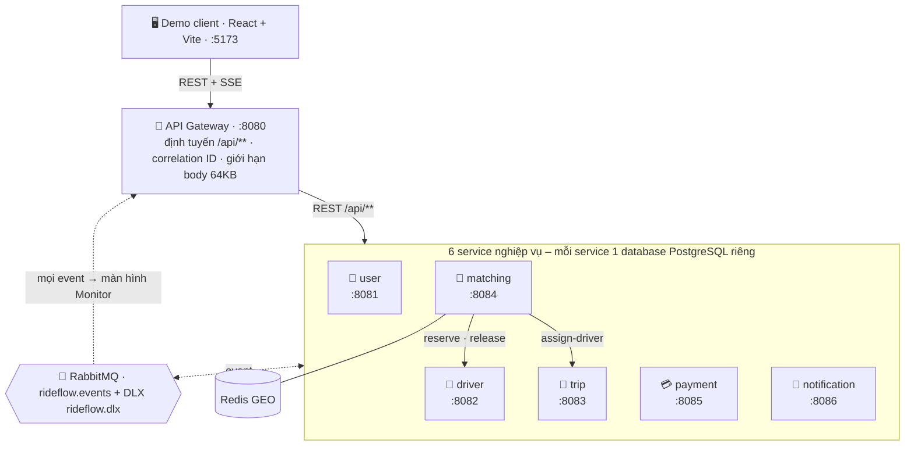
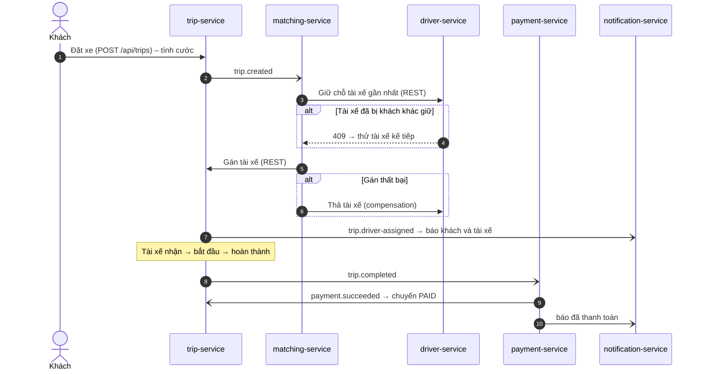

# RideFlow – Ride-hailing microservices (DS03)

Đồ án môn Hệ thống phân tán, topic **DS03**: mô phỏng Grab/Uber bằng microservices, minh hoạ **REST + message queue, Saga/compensation, atomic reservation, Transactional Outbox/Inbox, idempotency, bounded retry + DLQ, correlation ID**.

- Kế hoạch, đối chiếu đề bài: [`docs/plan/implementation-plan.md`](docs/plan/implementation-plan.md) (§11)
- Phân công, ma trận test, lịch đến 22/11: [`docs/plan/team-split.md`](docs/plan/team-split.md)
- Quy trình làm việc với AI agent: [`docs/plan/agentic-workflow.md`](docs/plan/agentic-workflow.md)
- **Quy tắc làm việc chung (mọi thành viên phải đọc): [`CONTRIBUTING.md`](CONTRIBUTING.md)**
- Hợp đồng: [`contracts/asyncapi/asyncapi.yaml`](contracts/asyncapi/asyncapi.yaml), [`contracts/openapi/public-api.yaml`](contracts/openapi/public-api.yaml)

## Kiến trúc

### Tổng quan



**Đường liền** = gọi REST đồng bộ · **Đường đứt** = event bất đồng bộ qua RabbitMQ.

### Các service

| Service | Port | Database | Nhiệm vụ chính | Phụ trách |
|---|---|---|---|---|
| api-gateway | 8080 | – | Cửa vào duy nhất `/api/**`, gắn `X-Correlation-Id`, chặn body > 64KB, đẩy event cho Monitor qua SSE | Cả nhóm |
| user-service | 8081 | `rideflow_user` | Đăng ký (role khách/tài xế), đăng nhập, JWT | A |
| driver-service | 8082 | `rideflow_driver` | Trạng thái, vị trí tài xế; **giữ chỗ nguyên tử** (1 tài xế không nhận 2 chuyến) | B |
| trip-service | 8083 | `rideflow_trip` | Vòng đời chuyến đi, tính cước | A |
| matching-service | 8084 | `rideflow_matching` + Redis | Tìm tài xế gần nhất, điều phối **Saga** và compensation | B (Saga), C (Redis) |
| payment-service | 8085 | `rideflow_payment` | Giả lập thanh toán khi chuyến hoàn thành | C |
| notification-service | 8086 | `rideflow_notification` | Gửi thông báo cho khách và tài xế; retry → DLQ | C |

### Giao tiếp

| Kiểu | Dùng khi | Cơ chế tin cậy |
|---|---|---|
| **REST đồng bộ** | Client → gateway → service; matching gọi `/internal/**` của driver/trip | Timeout, retry có giới hạn, `Idempotency-Key` |
| **Event bất đồng bộ** | Thông báo thay đổi trạng thái (`trip.created`, `driver.reserved`, `payment.succeeded`…) | Transactional Outbox khi gửi, Inbox chống trùng khi nhận, retry 2s → 5s → 10s rồi vào DLQ |
| **SSE** | Gateway đẩy toàn bộ event lên màn hình Monitor | Chỉ để quan sát khi demo |

### Luồng chính: đặt xe → hoàn thành → thanh toán



Mũi tên `->>` là REST, mũi tên `-)` là event qua RabbitMQ.

## Cấu trúc repo

```text
Prj-HeThongPhanTan-Nhom11/
├── README.md                    # mô tả, kiến trúc, cài đặt, chạy, demo, phân công
├── CONTRIBUTING.md              # quy tắc làm việc chung của nhóm (R0–R9, Git, checklist PR)
├── .env.example                 # mẫu cấu hình, KHÔNG chứa bí mật → copy thành .env
├── pom.xml                      # Maven gốc, gom 8 module Java
├── mvnw, mvnw.cmd, .mvn/        # Maven Wrapper – build không cần cài Maven
│
├── src/                         # ── MÃ NGUỒN ──
│   ├── libs/
│   │   └── rideflow-common/     # phần kỹ thuật dùng chung: EventEnvelope, Outbox/Inbox,
│   │                            #   correlation ID, retry → DLQ, luật ArchUnit
│   ├── services/
│   │   ├── api-gateway/         # :8080 cửa vào /api/**, event tap → SSE cho Monitor
│   │   ├── user-service/        # :8081 đăng ký, đăng nhập, JWT
│   │   ├── driver-service/      # :8082 trạng thái, vị trí, giữ chỗ tài xế
│   │   ├── trip-service/        # :8083 vòng đời chuyến, tính cước
│   │   ├── matching-service/    # :8084 ghép tài xế (Saga), Redis GEO
│   │   ├── payment-service/     # :8085 giả lập thanh toán
│   │   └── notification-service/# :8086 thông báo, retry → DLQ
│   └── demo-client/             # React + Vite :5173 – Passenger, Driver, Monitor, Kịch bản demo
│
├── deploy/                      # ── TRIỂN KHAI ──
│   ├── docker-compose.yml       # 10 container: 7 service + Postgres + RabbitMQ + Redis
│   ├── Dockerfile               # 1 Dockerfile dùng chung cho mọi service Java
│   └── postgres/                # script tạo 6 database
│
├── tests/
│   └── e2e/                     # kịch bản test chạy trên stack thật: regression, flow-a, flow-restart
├── scripts/                     # start.sh (chạy), compose.sh, fault.sh (gây lỗi), load.sh (sinh tải – C7)
├── contracts/                   # hợp đồng API: openapi/ (REST), asyncapi/ (event)
└── docs/
    ├── plan/                    # kế hoạch, phân công, quy trình
    ├── report.pdf               # (nộp cuối kỳ)
    └── slides.pdf               # (nộp cuối kỳ)
```

Bên trong **mỗi service** dùng cùng một layout (kiến trúc hexagonal, ArchUnit kiểm tra khi build). Ví dụ `trip-service`:

```text
src/services/trip-service/
├── pom.xml
└── src/
    ├── main/java/com/rideflow/trip/
    │   ├── TripServiceApplication.java
    │   ├── domain/model/            # Trip, TripStatus – Java thuần, không framework
    │   ├── application/             # use case (TripQueries…)
    │   │   └── port/out/            # interface cần từ bên ngoài (TripRepository)
    │   ├── adapter/
    │   │   ├── in/web/              # REST controller
    │   │   ├── in/messaging/        # nhận event RabbitMQ
    │   │   └── out/persistence/     # JPA entity + repository
    │   └── infrastructure/          # cấu hình Spring (queue, bean)
    ├── main/resources/
    │   ├── application.yml
    │   └── db/migration/            # Flyway: V1__messaging_tables.sql, V2__trips.sql
    └── test/java/…                  # unit test + ArchitectureTest
```

## Cài đặt & chạy (cũng là hướng dẫn redeploy)

Yêu cầu: Docker Desktop, Git Bash (Windows) hoặc bash, Node 18+. JDK 21+ chỉ cần khi chạy service ngoài Docker.

```bash
cp .env.example .env              # đổi mật khẩu trong .env, không commit file này
bash scripts/start.sh             # build + chạy 10 container, chờ tới khi mọi service UP
cd src/demo-client && npm install && npm run dev   # http://localhost:5173
```

- RabbitMQ UI: http://localhost:15672 (user/pass trong `.env`)
- Chạy riêng 1 service: `bash scripts/compose.sh up -d --build trip-service`
- Chỉ hạ tầng (chạy service từ IDE): `bash scripts/compose.sh up -d postgres rabbitmq redis`
- Dừng tất cả: `bash scripts/compose.sh down` (thêm `-v` để xoá dữ liệu)

## Build & test

```bash
./mvnw verify                                      # Windows: mvnw.cmd verify — unit test + ArchUnit
bash tests/e2e/regression.sh                       # stack đang chạy; phải 9/9
bash tests/e2e/flow-a.sh                           # Flow A; bước FAIL đầu tiên = tiến độ
bash tests/e2e/flow-restart.sh                     # tắt payment giữa luồng → bật lại → PAID
```

## Kịch bản demo (đề mục 7.4)

| # | Kịch bản | Cách chạy | Người trình bày |
|---|---|---|---|
| 1 | Start service độc lập; tài xế online | `scripts/compose.sh up -d <svc>`; Driver panel → Online | B |
| 2 | Khách đặt xe → Matching chọn tài xế → nhận → hoàn thành → thanh toán → thông báo (Flow A) | Passenger + Driver panel; theo dõi Events trên Monitor | A |
| 3 | 2 khách cùng lúc tranh 1 tài xế (Flow B) | Nút "Flow B: 2 khách cùng lúc" | B |
| 4 | Tắt service giữa luồng → message chờ trong queue → bật lại xử lý tiếp | `bash scripts/fault.sh kill payment-service` … `start` | C |
| 5 | Retry → DLQ → reprocess (Flow C) | Chaos fail-rate trên panel Kịch bản demo | C |
| 6 | Event trùng → xử lý 1 lần (Flow D) | Nút "replay" trên một event | C |
| 7 | Gán tài xế lỗi → Saga compensation (Flow E) | "Bật lỗi assign" rồi đặt xe | A + B |

### Tài khoản demo & Flow A bằng UI

Dữ liệu seed (không phải secret), mật khẩu chung `demo1234`: khách `passenger1@rideflow.demo`, `passenger2@rideflow.demo`; tài xế `driver1@rideflow.demo` … `driver3@rideflow.demo` (liên kết D01–D03). Cần `JWT_SECRET` ≥ 32 ký tự trong `.env`.

1. Passenger panel → Đăng nhập (đã điền sẵn passenger1) → Đặt xe; panel hiện trạng thái, cước.
2. Driver panel → Đăng nhập (driver1) → Bật Online (và cập nhật GPS) trước khi khách đặt xe.
3. Khi chuyến ở `DRIVER_ASSIGNED`: Driver panel bấm Accept → Start → Complete; xem PAID và notification trên Monitor.

## Phân công

Chi tiết từng task, điểm độ khó và ma trận test: [`docs/plan/team-split.md`](docs/plan/team-split.md).

| Thành viên | MSSV | Phụ trách | Demo flow | Chương report |
|---|---|---|---|---|
| A – Nguyễn Minh Đăng | | user-service, trip-service (vòng đời, tính cước), JWT gateway, Passenger panel; **7.5:** Consul discovery, dynamic pricing | A, E (trip) | 1–3, 4, 9, 12 + phần ch.13 |
| B – Phạm Hải Long | | driver-service (atomic reservation), matching-service (Saga), Driver panel; **7.5:** circuit breaker, nhiều instance | B, E (saga) | 5, 6, 7, 8, 10 + phần ch.13; tổng hợp report |
| C – Lê Nguyên Nhật Minh | | payment, notification (retry/DLQ), Redis GEO, CI, đo hiệu năng, Monitor; **7.5:** tracing Jaeger, log Loki/Grafana | C, D, restart | 11, 14, 15, 16–19 + phần ch.13; slides |

## Trạng thái

| Có sẵn (Phase 0) | Đang làm (xem team-split) |
|---|---|
| 7 service khởi động, health, Flyway schema, API đọc cho Monitor | Đặt xe, reserve, Saga, thanh toán, tính cước |
| `rideflow-common`: `EventEnvelope`, Outbox/Inbox, correlation filter, retry 2s/5s/10s → DLQ | JWT / đăng ký có role |
| Consumer mẫu có inbox (notification-service) | Chaos endpoint phía service, DLQ reprocess |
| Gateway: SSE monitor, health tổng, replay event, giới hạn body 64KB | Redis GEO projection |
| Eval: `regression.sh` 9/9; `flow-a.sh`, `flow-restart.sh` (đang đỏ – đúng kỳ vọng) | `flow-b/c/e.sh`, `scripts/load.sh` |

## Nguồn tham khảo

- Thư viện: Spring Boot 3.3, Spring Cloud Gateway, Spring AMQP, Flyway, ArchUnit, React, Vite.
